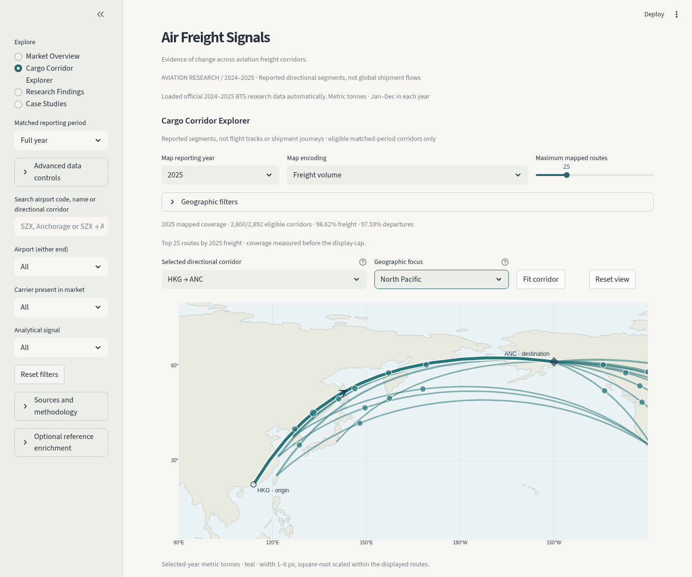
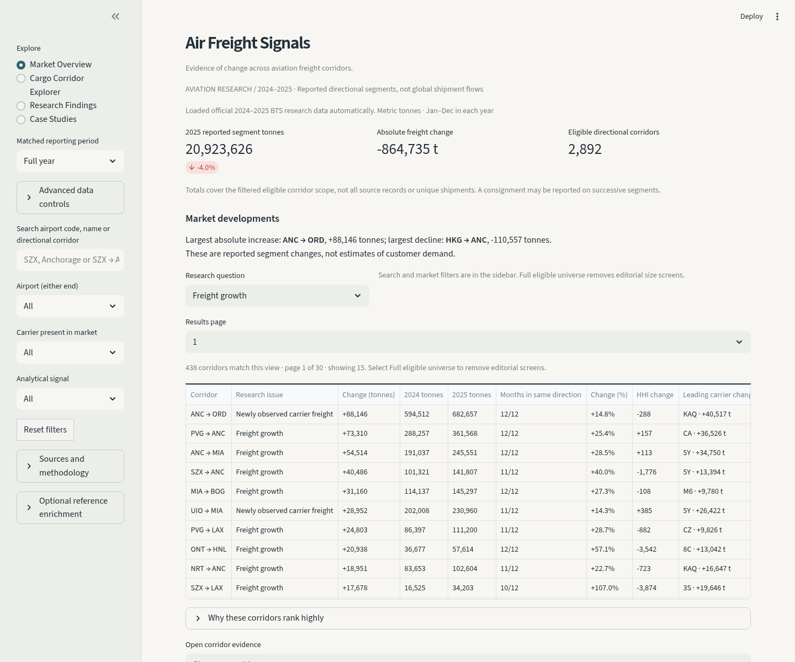
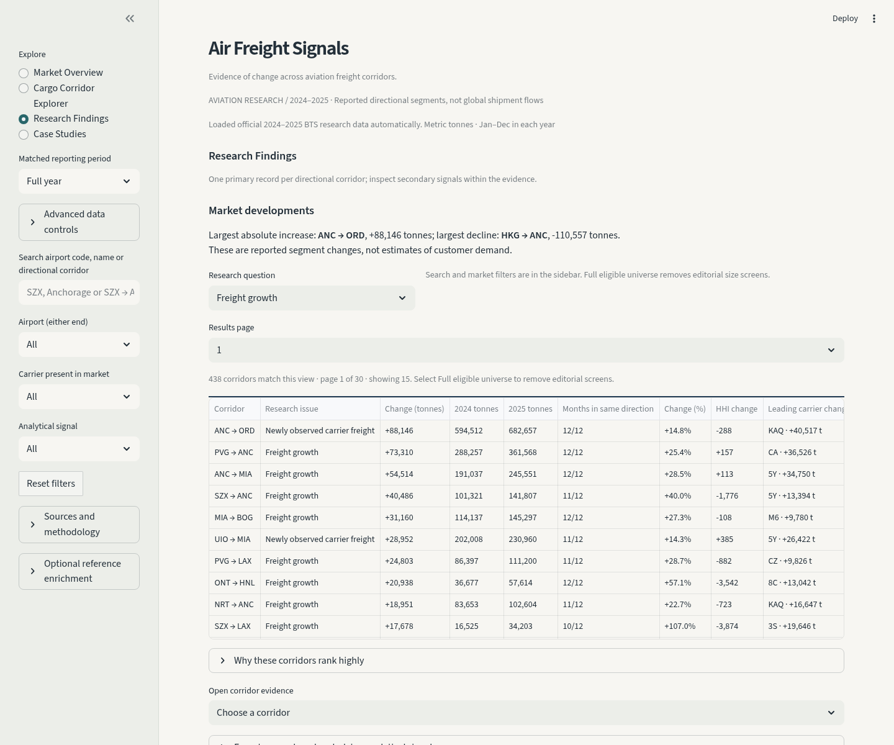
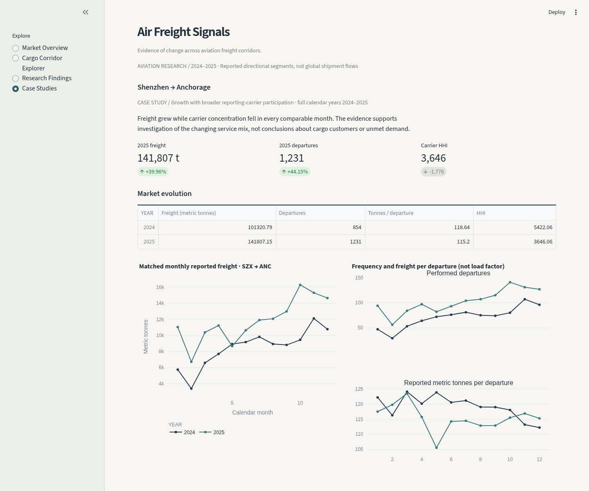
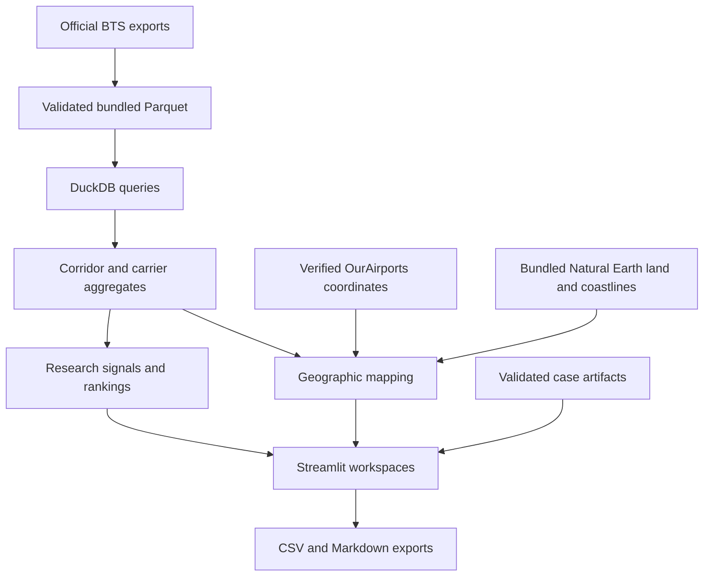

<h1 align="center">Air Freight Signals</h1>
<p align="center"><strong>Evidence of change across aviation freight corridors.</strong></p>
<p align="center">Independent research into reported air cargo markets.<br>Directional segments, carrier participation and geographic context · BTS, 2024–2025.</p>
<p align="center"><code>Python 3.12</code> · <code>DuckDB</code> · <code>Parquet</code> · <code>Streamlit</code> · <code>Plotly</code></p>
<p align="center"><a href="#overview">Overview</a> · <a href="#workspaces">Workspaces</a> · <a href="#research">Research</a> · <a href="#scope-and-methodology">Methodology</a> · <a href="#quick-start">Quick start</a> · <a href="#attribution">Attribution</a> · <a href="#about">About</a></p>

<a href="docs/screenshots/cargo-corridor-explorer.png"></a>

## Overview

Air Freight Signals investigates changes in **US DOT BTS T-100 Segment (All Carriers)** observations. Move from a reported market development to its monthly evidence, carrier composition and geographic context, then export the research for further analysis.

The application starts with **1,121,004 genuine 2024–2025 source observations** in a checked local Parquet package. No API key, hosted database, mapping service or manual upload is required. Source uploads remain available under advanced controls.

<table>
<tr><th>Market Overview</th><th>Research Findings</th><th>Shenzhen → Anchorage</th></tr>
<tr>
<td width="33%"><a href="docs/screenshots/market-overview.png"></a></td>
<td width="33%"><a href="docs/screenshots/research-findings.png"></a></td>
<td width="33%"><a href="docs/screenshots/shenzhen-anchorage.png"></a></td>
</tr>
</table>

*Authentic application captures: explorer, 6 November 2026; supporting views, 3 November 2026. Historical observations, not live monitoring. Full-year filters; the explorer highlights Hong Kong → Anchorage among its top 25 routes. [Capture details](docs/screenshots.md).*

## Workspaces

| Workspace | Research capability |
|---|---|
| **Market Overview** | Scoped freight totals, prioritized developments and directional corridor comparisons; bounded tables lead to underlying evidence. |
| **Cargo Corridor Explorer** | Offline directional routes, persistent camera controls, five metric encodings, airport-hub filters and coverage exports. |
| **Research Findings** | Freight growth, contraction and carrier-structure signals; search, pagination, matched-month analysis and CSV/Markdown exports. |
| **Case Studies** | Shenzhen → Anchorage investigated through annual and monthly evidence, carrier contributions, concentration, charts and downloadable narrative. |

## Research

| Directional corridor | Reported freight change, 2024 → 2025 |
|---|---:|
| Hong Kong → Anchorage | ≈ −17.4% |
| Shanghai → Anchorage | ≈ +25.4% |
| Shenzhen → Anchorage | +39.96% |
| Miami → Bogotá | ≈ +27.3% |
| Anchorage → Memphis | ≈ −26.5% |

These are selected findings, not a ranking of global commercial opportunities. [Evidence for all five corridors](docs/real-data-findings.md).

**Shenzhen → Anchorage:** freight rose from **101,320.79 to 141,807.15 metric tonnes**, departures from **854 to 1,231**, and carrier HHI fell from **5,422.06 to 3,646.06**. Freight grew in 11 matched months; concentration fell in all 12. Broader reported participation warrants investigation, but does not establish first-ever market entry or unmet customer demand. [Read the case](docs/cases/szx-anc/case-study.md).

## Scope and methodology

The unit of analysis is a **reported directional segment**, not an end-to-end shipment. Default eligibility requires every matched month and at least 100 metric tonnes and 30 departures in each year. Freight pounds convert to metric tonnes using 0.00045359237; mail is excluded. HHI uses all reporting-carrier freight shares without display rounding. Carrier filters select corridors without narrowing concentration denominators.

The default universe contains **2,892 corridors**; **2,800** map safely, representing **98.62% of eligible 2025 freight** and **97.59% of departures**. Airport references match 2,020 of 2,340 codes. Unmatched or country-conflicted endpoints remain in analytical totals and are excluded from geometry. Maps show at most 100 routes; coverage is measured before that cap.

Great-circle arcs are geographic context, not flown trajectories. Reported growth does not measure customer demand, utilization, revenue or profitability. Reporting revisions and carrier/service mix affect comparisons; customers, shippers and forwarders are not identified.

[Analytical methodology](docs/methodology.md) · [Ranking conventions](docs/research-workflow.md) · [Geographic coverage](docs/geographic-methodology.md)

## Architecture



DuckDB queries the local package into narrow Pandas aggregates. Cached calculations, 15-row research pages and lazy map/case rendering keep the interface bounded. Plotly renders local land and coastlines without remote tiles. [Architecture](docs/architecture.md).

## Quick start

Install Git and **Python 3.12**:

```sh
git clone https://github.com/asencerg/air-freight-signals.git
cd air-freight-signals
```

**macOS / Linux**

```sh
python3.12 -m venv .venv
.venv/bin/python -m pip install -r requirements.txt
.venv/bin/python -m streamlit run app.py --browser.gatherUsageStats false
```

**Windows PowerShell**

```powershell
py -3.12 -m venv .venv
.\.venv\Scripts\python.exe -m pip install -r requirements.txt
.\.venv\Scripts\python.exe -m streamlit run app.py --browser.gatherUsageStats false
```

Open **http://localhost:8501**. Installation normally needs network access; the bundled analysis and maps run locally afterward. Missing or corrupted data produces an explicit message, not replacement observations.

## Testing and reproducibility

Use the virtual environment's Python (`.venv/bin/python` on macOS/Linux; `.\.venv\Scripts\python.exe` on Windows):

```sh
python -m pip install -r requirements-dev.txt
python -m pytest -q
python scripts/audit_geography.py
```

Tests cover package hashes, all five findings, matched periods, HHI, geography, navigation and exports. Original-source integration tests skip when the separately acquired archives are absent; mandatory bundled-data tests do not. [Package hashes and optional rebuild](docs/processed-data.md) · [Source reconciliation](docs/official-data-reconciliation.md) · [Optional browser regression checks](docs/browser-testing.md).

## Attribution

The **US Department of Transportation, Bureau of Transportation Statistics** supplies the T-100 observations; **OurAirports** supplies airport references; **Natural Earth** supplies land and coastline context. Source acknowledgment does not imply endorsement.

[Data provenance and source conditions](docs/data-provenance.md) · [Geographic sources](docs/geographic-sources.md)

## License

No license has been selected for the original code, reports or screenshots. BTS observations, OurAirports references, Natural Earth geography and dependencies have separate [source-specific conditions](docs/data-provenance.md).

## About

Created by **A. Sencer Gözübenli**  
Data Engineer  
*Focusing on supply chain analytics, geospatial risk modeling, and data-informed decision systems.*
